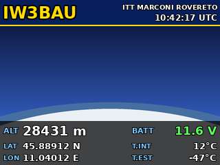

# SONDA-BALOON-3Q — ITT Marconi Rovereto — IW3BAU

Software per la scatola della sonda stratosferica (Raspberry Pi Zero):

- legge **DHT11** (temperatura/umidità interna) e **ADS1115** (tensione batteria 12 V)
- manda alla **Vaisala RS41**, sulla porta **XDATA**, frame OIF411 con temperatura
  interna e batteria: la RS41 li trasmette a terra insieme ai suoi dati
- legge anche eventuali dati in arrivo dalla RS41 sulla stessa seriale
- salva tutto sulla **SD**, con ora e cartelle ordinate
- scatta una foto con la **camera v1.2**, la **impagina** con logo, nominativo e
  dati, e la trasmette in **SSTV** su **433.500 MHz** (NBFM) dal **GPIO20**
- dopo ogni immagine trasmette l'identificativo in Morse `DE IW3BAU`

```
sonda/
  config.py          <- TUTTE le impostazioni (pin, tempi, frequenza, modo SSTV...)
  main.py            <- programma principale
  sensori.py         <- DHT11 + ADS1115
  rs41.py            <- lettura e decodifica XDATA della RS41
  camera.py          <- foto
  impaginazione.py   <- grafica dell'immagine SSTV
  codifica_sstv.py   <- codificatore SSTV (Robot36 / Martin M1 / PD120)
  radio.py           <- modulazione FM e trasmissione con rpitx
assets/logo_marconi.png  <- METTETE QUI IL LOGO (PNG, meglio con sfondo trasparente)
install.sh           <- installazione completa sul Raspberry
sonda.service        <- avvio automatico all'accensione
```

## Esempio di immagine trasmessa



`python3 sonda/main.py --test` crea in `test_output/` le immagini e i file
audio WAV di prova per tutti i modi. Barra in alto: logo + **IW3BAU** +
ora UTC; in basso: altitudine, coordinate, batteria (verde/giallo/rosso),
temperatura interna ed esterna. I valori RS41 diventano **arancioni** se
non arrivano dati da più di 60 s, e compare `--` se un sensore è guasto.

## Collegamenti (numerazione BCM)

| Cosa | GPIO | Pin fisico | Note |
|---|---|---|---|
| ADS1115 SDA | GPIO2 | 3 | I2C, indirizzo 0x48 (ADDR → GND) |
| ADS1115 SCL | GPIO3 | 5 | |
| ADS1115 VDD | 3.3 V | 1 | alimentatelo a 3.3 V, non 5 V |
| DHT11 DATA | GPIO17 | 11 | pull-up 10k verso 3.3 V (se il modulo non l'ha già) |
| Uscita RF → filtro → ampli | GPIO20 | 38 | GND sul pin 39 |
| Pi TX → XDATA IN RS41 | GPIO14 | 8 | 3.3 V, 9600 8N1, frame OIF411 |
| Pi RX ← XDATA OUT RS41 | GPIO15 | 10 | |
| GND comune con RS41 | GND | 6 | **obbligatorio** |

## ⚠️ Cose da controllare PRIMA del volo

1. **Batteria su A0: serve un partitore di tensione.** L'ADS1115 accetta al
   massimo VDD + 0.3 V sull'ingresso: 12 V diretti lo distruggono.
   Esempio: 33 kΩ dalla batteria ad A0 e 10 kΩ da A0 a GND (12.6 V → 2.93 V).
   Mettete i valori in `config.py` e calibrate il `FATTORE_PARTITORE` con un
   multimetro (`tensione vera / tensione letta`).
2. **RS41 XDATA.** Collegate la RS41 a un adattatore USB-seriale 3.3 V e
   guardate cosa esce davvero (`screen /dev/ttyUSB0 9600`). Il firmware
   originale Vaisala usa la porta XDATA soprattutto per *ricevere* dati da
   strumenti esterni: se la vostra RS41 non manda posizione/altitudine sulla
   seriale, nell'immagine vedrete `--`. Il programma accetta frasi **NMEA**
   (`$GPGGA`, `$GPRMC`) e righe tipo `alt=12345,lat=45.8,lon=11.0,temp=-40`,
   e salva **comunque ogni riga grezza** in `rs41_xdata_raw.log`. Se il
   formato è diverso, si adatta solo la funzione `analizza_riga` in `rs41.py`. Se la RS41 non fornisce la
   posizione, la soluzione più semplice è un piccolo modulo GPS sulla seriale
   (che manda NMEA: funziona già senza cambiare codice).
3. **DHT11: misura solo da 0 a 50 °C.** Dentro la scatola in stratosfera si
   può scendere sotto zero: valutate un DHT22, DS18B20 o BME280.
4. **Filtro obbligatorio.** Il GPIO genera un'onda quadra piena di armoniche
   (867 MHz, 1.3 GHz...). Controllate con un SDR che dopo filtro + ampli ci
   sia solo 433.5 MHz. Calibrate l'errore del quarzo del Pi con
   `PPM_CORREZIONE` in `config.py`.
5. **Frequenza e autorizzazioni.** Nel band plan IARU Regione 1, 433.500 MHz
   è il canale di chiamata FM simplex: verificate con l'OM titolare del
   nominativo / la sezione ARI la frequenza più adatta e le regole per
   trasmettere da un pallone. Il lancio richiede le autorizzazioni ENAC.
6. **Ampli e calore.** In quota non c'è aria per raffreddare l'ampli da 2 W:
   per questo c'è una pausa tra le trasmissioni (`PAUSA_TRA_IMMAGINI_S`).
   Robot36 = ~44 s di trasmissione, poi 90 s di pausa.
7. **Ora.** Il Pi Zero non ha orologio a batteria: senza internet l'ora è
   sbagliata. Il programma la corregge dalla data/ora GPS della RS41 se
   disponibile; in ogni riga c'è anche `uptime_s` (secondi dall'accensione).

## Installazione sul Raspberry

### 1. Preparare la SD (sul PC)

1. Scaricate **Raspberry Pi Imager** (raspberrypi.com/software).
2. Dispositivo: *Raspberry Pi Zero* (o *Zero 2 W*); sistema: **Raspberry Pi OS Lite (64-bit
   per Zero 2 W, 32-bit per Zero / Zero W)**; scheda: la vostra microSD.
3. Prima di scrivere, in **Modifica impostazioni**:
   - nome host: `sonda`
   - utente/password (es. `pi` / una password vostra)
   - **Wi-Fi** della scuola o dell'hotspot del telefono
   - scheda *Servizi*: **abilita SSH** (con password)
4. Scrivete, mettete la SD nel Pi e alimentatelo. Dopo 1-2 minuti è in rete.

> Il Pi Zero *senza* W non ha Wi-Fi: per l'installazione serve un adattatore
> USB-Ethernet (internet serve solo adesso, in volo no).

### 2. Collegarsi e copiare il programma

Dal PC (Windows: PowerShell; Mac/Linux: Terminale):

```bash
ssh pi@sonda.local
```

Sul Raspberry:

```bash
sudo apt-get install -y git
git clone -b ccr-665dc920-hbsa5z https://github.com/feedloo/SONDA-BALOON-3Q.git SONDA-BALOON-3Q
cd SONDA-BALOON-3Q
```

Se il repository è privato e `git clone` chiede la password, scaricate lo ZIP
da GitHub sul PC e copiatelo con `scp` (o WinSCP su Windows):

```bash
# dal PC
scp -r SONDA-BALOON-3Q pi@sonda.local:/home/pi/
```

Copiate anche il logo: `assets/logo_marconi.png`.

### 3. Installare

```bash
cd ~/SONDA-BALOON-3Q
sudo ./install.sh        # 20-40 minuti su un Pi Zero (compila rpitx)
sudo reboot
```

`install.sh` installa le librerie, compila **rpitx** (solo `sendiq`) con una
patch che porta la RF sul **GPIO20** invece che sul GPIO4, attiva I2C, UART
(e disattiva la console seriale e il Bluetooth, che la userebbero), imposta
`gpu_freq=250` / `force_turbo=1` per avere una frequenza stabile e prepara il
servizio di avvio automatico (non ancora attivo).

Verifiche dopo il riavvio:

```bash
i2cdetect -y 1            # deve comparire 48 (ADS1115)
rpicam-still -o prova.jpg # la camera funziona?
```

### 4. Avvio automatico all'accensione

Quando le prove (sotto) sono andate bene:

```bash
sudo systemctl enable sonda    # da ora parte da solo ad ogni accensione
sudo reboot                    # oppure: sudo systemctl start sonda
```

Cosa succede quando date alimentazione:

1. il Raspberry si avvia (~30-40 s su un Pi Zero)
2. il servizio aspetta **20 secondi** (`ExecStartPre=/bin/sleep 20` in
   `sonda.service`: cambiate il numero se volete un'attesa diversa, poi
   rilanciate `sudo ./install.sh` oppure modificate direttamente
   `/etc/systemd/system/sonda.service` e date `sudo systemctl daemon-reload`)
3. parte il programma: sensori ogni 10 s, prima immagine dopo ~5 s
4. se il programma si blocca o va in errore, viene **riavviato da solo** dopo 10 s

Comandi utili:

```bash
systemctl status sonda         # sta girando?
journalctl -u sonda -f         # messaggi in diretta (Ctrl+C per uscire)
sudo systemctl stop sonda      # ferma (es. per lavorare sulla scatola senza trasmettere)
sudo systemctl disable sonda   # toglie l'avvio automatico
ls ~/SONDA-BALOON-3Q/dati/     # cartelle dei voli salvati
```

> Prima del lancio: con il servizio attivo, spegnete e riaccendete la scatola
> **completa** (batteria vera, niente PC collegato) e controllate con il
> ricevitore che entro circa un minuto arrivi la prima immagine.

## Prove (in quest'ordine)

```bash
# 1. sul PC o sul Pi, senza hardware: crea immagini + WAV in test_output/
python3 sonda/main.py --test
#    riproducete il WAV vicino al telefono con l'app "Robot36" o in MMSSTV/QSSTV

# 2. sul Pi: tutto vero (sensori, RS41, camera, SD) tranne la radio
sudo venv/bin/python sonda/main.py --simula

# 3. trasmissione vera: ampli su CARICO FITTIZIO 50 Ω, ricevitore/SDR vicino in NBFM
sudo venv/bin/python sonda/main.py

# 4. avvio automatico ad ogni accensione (vedi sopra)
sudo systemctl enable --now sonda
```

## XDATA verso la RS41 (emulazione OIF411)

Ogni secondo il Pi manda alla RS41 un frame di 27 byte, nello stesso formato di
`tx_xdata_frame_sensors.py` (protocollo identico, verificato byte per byte):

```
xdata=0501 TTTT RRRRR BB CCC 00 \r
           |    |     |  |
           |    |     |  +-- corrente mA (costante, XDATA_CURRENT_MA)
           |    |     +----- batteria, 0.1 V   (ADS1115)
           |    +----------- radiazione (costante, XDATA_RADIATION)
           +---------------- temperatura interna, bit15 = segno, x100 (DHT11)
```

Se un sensore non ha una lettura valida da più di `XDATA_STALE_S` secondi,
nel frame va il valore di fallback (`XDATA_FALLBACK_TEMP_C` / `_BATT_V`).
I frame inviati sono salvati con `TX` in `rs41_xdata_raw.log`.

Prova da sola della seriale (come lo script originale):

```bash
sudo systemctl stop sonda
sudo venv/bin/python sonda/main.py --solo-xdata     # Ctrl+C per il riepilogo
```

## Dati salvati sulla SD

Ogni accensione crea una nuova cartella (niente sovrascritture):

```
dati/volo_001_2026-11-19_10-30-00/
  telemetria.csv      ogni 10 s: ora, uptime, T/U interne, batteria, tutti i dati RS41, T CPU
  rs41_xdata_raw.log  seriale XDATA: RX = ricevuto dalla RS41, TX = frame inviati
  immagini.csv        elenco immagini trasmesse con i dati usati
  eventi.log          log del programma (errori, trasmissioni)
  foto/               foto originali a piena risoluzione (2592x1944)
  sstv/               immagini esattamente come sono state trasmesse
```

Il CSV si apre direttamente con Excel / LibreOffice per fare i grafici.
Ogni riga viene scritta subito su disco (fsync): se la batteria si stacca
all'atterraggio si perde al massimo l'ultima riga.

## Ricezione a terra

Ricevitore o SDR su **433.500 MHz NBFM**, audio nel PC con **MMSSTV**
(Windows), **QSSTV** (Linux) o sul telefono con l'app **Robot36**.
Il modo si sceglie in `config.py` (`MODO_SSTV`):

| Modo | Durata | Risoluzione | Note |
|---|---|---|---|
| `robot36` | ~36 s | 320×240 | predefinito: veloce, consuma meno |
| `martin1` | ~114 s | 320×256 | colori migliori, più resistente |
| `pd120` | ~126 s | 640×496 | massima qualità |

Il codificatore è stato verificato decodificando i WAV generati con un
decoder SSTV indipendente (tutti e tre i modi riconosciuti dal codice VIS e
decodificati completi), anche dopo modulazione FM e aggiunta di rumore.
